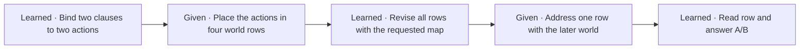

# Self Without a Transcript

## Reading, changing and reusing a conditional policy

**Research working paper · November 4, 2026**

### Abstract

What must a model retain if a stated policy will be edited again after its words are gone? On eight familiar topics, a learned memory drove all 3,072 single-edit Gemma choices correctly under familiar wording, but a second edit could reverse the roles of the two stored actions. A separate attempt to expand and reintegrate the rule directly in raw slots gave 252/512 after native-gradient training, against 256/512 for zero slots. For the structured action memory we constructed two histories with identical current choices and opposite correct next choices. Only a nine-parameter controller was trained in this comparison. An external scorer compared frozen Gemma's choices with the correct actions to award a scalar reward after each edit. Without role labels the controller learned which role occupied the first row and got both histories right on all 9,216 pairs in each of three seeds, matching explicit supervision. With the bit erased, zero pairs succeeded. The registered multi-depth criterion failed because the no-bit control also ended correctly on the 36 selected four-edit strings. An exhaustive follow-up found that control correct throughout all four edits on 12.5% of trajectories, versus 100% with either learned bit. The scope is a fixed two-action interface with supplied trigger masks.

## 1. A rule for choosing a route

A walker says, “I take the river path when signals Alder and Birch are both on. Otherwise I take the ridge path.” Tomorrow Alder is on and Birch is off. The walker should take the ridge path. Now suppose the original sentence is gone. Could a model work from its current representation, expand the rule into cases, turn those cases back into a rule, and still choose the ridge path when asked tomorrow? What would change if it had to put its intermediate state into words?

| Form of the same policy | What the model would need to preserve |
| --- | --- |
| Original description | Take the river path when both signals are on. In every other situation take the ridge path. |
| Exhaustive cases | Off/off, ridge. Off/on, ridge. On/off, ridge. On/on, river. |
| Reintegrated rule | Take the ridge path by default. Switch to the river path exactly when both signals are on. |

Writing out the cases above preserves the route in every world. The intervention we test in this paper changes the rule itself. If either lamp now suffices for the river, the walker switches routes on days with just one lamp on and keeps the old route when both are on. This gives us a positive check on the update and a check on what it must preserve. Exchanging river and ridge gives an opposed policy. A future experiment will ask whether the model itself can rewrite an equivalent rule and how putting its state into words affects its next decision.

We first ask which distinction survives in a question-free state and whether exchanging a state changes a native answer. We then remove the policy words, change a trigger, and test whether the new state can drive a second edit. Finally we give two walkers the same current action table but different branch roles and ask whether the learner writes the information its next edit will need. The first-person frame supplies the policy. Testing an effect specific to self-attribution would require matched third-person and impersonal descriptions.

## 2. What is read, and by whom?

**Reading a state.** An encoder reads a description before any evaluation question appears. We retain eight vectors at a specified layer and call this state $E(s)$. A source probe learns a score from these vectors to predict a feature of the description. A high probe score establishes that the fitted reader can recover that feature from one state. In a separate test, we inject a state into a task prompt and read the language model's own next token. We call this the *native answer*. An *opposed donor* supplies the state of the other policy while the question and its displayed options stay fixed.

**Reading a choice.** Every binary action question is presented twice, with the options exchanged. Native correctness requires the most likely token over the full vocabulary to be the requested letter. Other tokens count as errors. A strict unit in the conditional experiments fixes topic, flag-name pair, wording and representation stage. It passes only when both policies are correct in all four worlds, in every genuine source order and in both label orders. For example, a reader that always follows the last clause can score many individual decisions and still fail the entire unit. The original description and the table each have two orders. The reintegrated rule has one realization per wording family.

Earlier Mistral-7B-Instruct-v0.3 and Gemma-2-2B-IT probes explain the ordering of our tests. Both models answered 24/24 preference questions from literal descriptions. Twenty-four distinct updated slot tensors nevertheless produced one verbalization per checkpoint, and all 12 re-encoded donor contrasts tied. Replaying states from positions that had already processed both options could reproduce native lexical choices. A recurrence needs a state formed *before* the question. The original tests of uncalibrated transport, output positions and stopping conditions are indexed in the supplement. [Development experiments 1–8](DEVELOPMENT_RECORD.md#study-1)

## Related work

The Quine Test studies whether descriptions reproduce preference profiles in fresh instances [Babu et al. (2026)](https://arxiv.org/abs/2610.38726v1). Propositional probes distinguish facts and their relational bindings in context [Feng et al. (2024)](https://arxiv.org/abs/2406.19501v2). Our verdict probe asks which of two familiar judgment roles survives a change in the action words. The donor and branch exchanges address the separate question of causal use. Coconut trains reasoning through continuous hidden-state feedback [Hao et al. (2024)](https://arxiv.org/abs/2412.06769), and recurrent-depth models allocate repeated computation within a network [Geiping et al. (2025)](https://arxiv.org/abs/2502.05171). Natural Language Autoencoders provide a learned activation-to-language-to-activation interface [Fraser-Taliente et al. (2026)](https://transformer-circuits.pub/2026/nla/index.html). The planned language insertion compares later use on the two paths from the very same intermediate state.

## 3. A frozen state preserves the order of familiar verdicts

Consider a two-record description that accepts the river route and rejects the ridge route. Hold the two actions and their mention order fixed, then exchange the verdicts. The two descriptions contain the same tokens and the same slot positions, yet which action is accepted changes. A reader using only one question-free state can be tested on each member independently.

We froze Gemma-2-2B-IT and trained a linear score with a fitted offset on 4,608 such records. The readout predicted whether the first record accepted its action. A second readout predicted which action was mentioned first within an inferred topic. Combining the two predictions selected the preferred action. Evaluation used 64 unfamiliar action expressions across eight known topics, two familiar verdict vocabularies, both field placements, both action orders and both policies. The 2,048 states are repeated realizations of 16 policies within those topics.

| Question asked of one held-out state | Correct | Comparison or consequence |
| --- | ---: | --- |
| Is the first action accepted? | 2,043/2,048 | Shuffling the training role supervision gave 1,022/2,048. |
| Are both members of an opposed pair read correctly? | 1,019/1,024 pairs | Each member was read separately. |
| Which specific action is preferred? | 1,311/2,048 | Topic routing and action identity also have to be correct. |

The role result passed its registered criterion in all four combinations of verdict vocabulary and field placement. A fit without extra weight on opposed pairs was equally accurate on the role. Each description contains one acceptance and one rejection, so a cue in either record can reveal their order. The result establishes a recoverable *order of familiar verdicts* under action rephrasing. The complete-policy errors locate the next difficulty. In 527 of the 737 errors, topic and verdict order were correct but the reader identified the wrong first action. Another 206 involved an incorrect topic and four identified the right action but assigned it the wrong verdict within the correct topic. [Probe, shuffled control and error partition](../provenance/role_exchange_20261103/RESULTS.md)

## 4. When a source state changes a model answer

A separate intervention asks whether a source can drive a native choice. We first established that eight vectors derived from explicit option words could influence a frozen Gemma reader. We then fitted a map from a question-free source encoding into this working input space. At test time the map received one source state. The downstream question contained the displayed alternatives, and the model produced its ordinary next-token scores. Source and recipient were frozen during fitting of the map. [Word-derived input control](../provenance/slot_readout_20261103/RESULTS.md)

On the 32 fitting states the mapped sources gave 64/64 native choices. Opposed donors reduced the score against the original gold to 0/64 and reversed the A/B margin on all 64 judgments. The fitting mean and zero inputs each gave 32/64. Wording of the question transferred better than wording of the source. The same states gave 62/64 under a withheld question wording, whereas changed source wording yielded 57/128 and two new topics yielded 30/64. This establishes causal use of the supplied preference on its fitting bank. General conditional reading requires a further operation. The same stored policy now has to yield *different* actions depending on the later world. [Source exchange and transfer panels](../provenance/source_lexical_20261103/RESULTS.md)

We tested that operation on the eight known action topics by supplying each original description, case table and reintegrated rule independently. These were experimenter-authored teachers. None was generated by a learned update. Native choices from ordinary slots were 127/256, 128/256 and 64/128, respectively, against balanced zero-state counts of 128/256, 128/256 and 64/128. Literal text gave 219/256, 215/256 and 88/128. Because even the original text left errors, the next experiment trained a reader on text before admitting slot learning. [Independent teacher controls](../provenance/action_operation_20261103/RESULTS.md)

Literal training and one fixed continuation raised fitting accuracy to 3,751/3,840 (97.7%). The corresponding strict counts were 23/48 for the original description, 28/48 for the table and 47/48 for the rule. Only the rule cleared the fitting requirement of 95% native and 90% strict. New names, source wording and questions gave 923/1,280 native choices. Of 89 fitting errors, 85 returned B when A was correct. This discrepancy motivates the curriculum comparison. It keeps both label orders, separates changes in names, grammar and questions, and asks where the decision fails when its parts can be tested independently. [Literal curriculum](../provenance/conditional_curriculum_20261103/RESULTS.md) · [Margin continuation and label-order diagnostic](../provenance/conditional_margin_20261103/RESULTS.md)

## 5. From two flags to an action

We compared two curricula from the same saved literal Gemma reader. *Practise the final choice* (`direct`) trained on actions given the policy and two flag values. *Learn the parts of the choice* (`parts`) divided its targets equally among reading a flag, deciding whether both flags were on, choosing from a supplied condition bit and answering the full action question. Both trained rank-16 query/value adapters for 384 updates in the final four layers, with 12,288 labels and 1,747,152 padded tokens. We froze the endpoints before crossing familiar and new signal names, source grammars and question wordings. The primary comparison used the cell in which all three changed.

For the two-call route, the first call saw just the two readings and answered whether both were on. A fixed rendering of that Boolean and the original policy text went to the second call. The two calls had independently swapped A/B labels. We also complemented the bit at fixed policy, exchanged the policy at fixed bit and supplied the true bit. These interventions distinguish errors in reading the world from errors in applying the policy.

| Training | Direct action | Two calls, predicted bit | Both bit settings correct | Strict two-call units |
| --- | ---: | ---: | ---: | ---: |
| Final choice | 1,165/1,280 | 1,932/2,560 | 1,718/2,560 | 0/48 |
| Learn parts | 1,159/1,280 | 2,234/2,560 | 2,049/2,560 | 11/48 |

Compared with final-choice training, component practice lost 6 of 1,280 direct answers on net and gained 302 of 2,560 composed paths. Those paths reuse 16 distinct conjunction judgments and 640 distinct second-call responses per arm. Supplying the true bit gave 2,370/2,560 for component practice and 2,328/2,560 for final-choice practice. The registered five-point direct-transfer advantage and the full absolute intervention criterion both failed. Most importantly for the next experiment, even a correct conjunction says nothing about which action the walker takes. The second call still had the original policy in front of it. [Crossed panels, label controls and criteria](../provenance/two_flags_20261104/RESULTS.md)

### 5.1. When a familiar rule frame stops working

The earlier margin-trained reader had met 47/48 fitting strict units on compact rules, compared with 23/48 on descriptions and 28/48 on case tables. After component training the fitting counts were 48/48, 41/48 and 38/48 respectively. On the earlier jointly new panel, direct answers passed 4/48 strict units (1/16 descriptions, 0/16 cases and 3/16 rules). The same reader passed 11/48 units on this panel when it first evaluated the conjunction and then chose an action, as shown in the preceding table. Each direct unit requires 32 correct choices for a description or case table, covering both presentation orders, and 16 for the single-order compact rule. All 44 ordinary case errors occurred in forward table order. We asked whether broader wording practice or additional branch supervision could close the gap.

Three continuations began from the same component reader and received 400 updates, 12,800 labels and identical padded-token budgets. At equal task proportions, widening the grammar bank raised ordinary new-panel accuracy from 1,169 to 1,187 of 1,280. With that wider bank, assigning seven of sixteen label pairs to branch binding and five to conjunction gave 1,182. The focus reader reached 44/48, 45/48 and 48/48 strict units on the two original fitting families, but only 44/96, 47/96 and 91/96 on all four training families (description, cases, rule).

On the new panel the unchanged parent and all three continuations already answered every conjunction correctly in both label orders. The focus reader's composed counts were 958/1,024, 986/1,024 and 238/512. Its complete units were 4/16, 6/16 and 0/16. The constructive criterion failed. A separate frozen audit kept the new lamp names and a familiar question fixed, supplied the true Boolean and varied the compact rule and the wording of the bit report.

| Compact rule, same question and names | Familiar bit report | New bit report |
| --- | ---: | ---: |
| Familiar if/else wording | 127/128 | 126/128 |
| New notebook wording | 88/128 | 60/128 |

The familiar rule gives the switched action first, and the notebook rule starts with the default. For a true bit, “The joint test says that both indicators are on.” became “Each of the two current settings is on.” Across both bit values, changing the bit sentence cost one choice on the familiar rule and 28 on the notebook rule. In the new-rule/new-bit cell, false-bit choices stayed correct on 60/64 and true-bit choices fell to 0/64. The table weights both bit values equally and the composed counts above weight the four worlds equally. These are effects of the specific wordings and this frozen reader. [Training comparison, wording cross and scoring audit](../provenance/stage_grammar_20261104/RESULTS.md#a-frozen-cross-of-grammar-bit-wording-and-question)

## 6. Changing the policy after its words are gone

The walker takes the ridge by default and the river when both lamps are on. Now change the trigger to either lamp. With just one on, the walker should switch from ridge to river. With both on, the route should stay the same. We use these changed and unchanged worlds to test whether a later computation actually revises a remembered policy.

A frozen Gemma encoded the two clauses separately, before any later world or choices appeared. Two supervised heads, trained on 288 labelled clauses, identified each clause's role and action among 16 familiar actions. The two resulting soft action distributions populated the ordinary case table. Off/off, off/on and on/off received the default distribution, and on/on received the switched distribution. This initial layout was prescribed. For each requested trigger, a four-by-four map learned to revise the whole table from 288 fitting policy realizations. Its targets were the correct action identities in all four worlds under that trigger. A world address entered only after the revised table was complete. The native Gemma reader received that row as a continuous mixture of action embeddings, together with the two displayed alternatives. It received no original words or source attention.

*Figure 1. Only the current table and the requested operation enter the revision. The world and displayed alternatives arrive later.*

Both panels used new lamp names, both clause orders and both A/B orders. The primary panel used two familiar clause patterns. The challenge used a new contrast between reaching full illumination and falling short of it. A correct opposed exchange required the original and donor choices to be correct with a reversed A/B margin.

| Outcome | Familiar wording | New wording |
| --- | ---: | ---: |
| Correct complete midpoint | 128/128 | 32/64 |
| Native action after one edit | 3,072/3,072 | 1,140/1,536 |
| Correct original and opposed reversal | 3,072/3,072 | 744/1,536 |
| All 96 judgments in a strict unit | 32/32 | 3/16 |

*Both panels repeat 16 policy bindings. The primary total consists of 32 topic/name/wording units of 96 judgments each. Each unit crosses both policies, both clause orders, four worlds, three operations and both label mappings. The new-wording panel has 16 such units.*

On familiar wording, exchanging only the switched-action row changed the correct choice on all 1,536 affected judgments and preserved it on all 1,536 unaffected judgments. Replacing only the default rows gave the same counts. Updating solved all 1,280 judgments whose correct choice changed, while skipping the update solved zero. On the other 1,792, both paths were completely correct. Uniform memory gave 1,536/3,072. All registered primary criteria passed.

On new wording only 32 of 64 midpoints recovered both branch actions. In 20 incomplete memories both branches named the same action on the correct menu. In another 12 at least one branch pointed outside the menu. The correct one-hot policy drove all 1,536 answers through the same update and reader. The wording challenge missed its gate. Across both panels and eight interventions, 36,864 requests shared 1,740 distinct native inputs. [Native outputs and intervention scores](../provenance/state_only_20261104/RESULTS.md)

We then froze a follow-up test on the already scored primary panel. A second edit replaced the first trigger while preserving the two branch actions. The updater received its own complete output and the new operation, without the first operation's name. When the first trigger was both-on, the second edit was correct on 3,072/3,072 judgments across the three requested triggers. After either-on the count was 1,536/3,072. After exactly-one-on it was 0/3,072. Opposed donors still flipped all 3,072 answers in that last condition, but both answers in each pair contradicted their policies. Only three of nine sequences met the reuse criterion. All first edits on these policies had been correct. [Nine sequences and frozen follow-up design](../provenance/state_only_20261104/COMPOSITION_PLAN.md)

The fitted map gave the first three input rows equal weights when reading the default. All three had held the default during fitting. After an exactly-one edit, two held the switched action, and the fourth row held the default. We tested whether those roles remained recoverable in the same intermediate tables.

In a separately sealed diagnostic, a fixed rule took the off/off row as the default and selected the most different of the other three soft rows as the switched action. It restored the original layout and passed it to the same learned update and native reader. Only the incoming table was consulted. Across the nine sequences, accuracy rose from 4,608/9,216 to 9,216/9,216. Deliberately exchanging the two recovered roles gave 0/9,216. The two actions survived the first edit and were accessible under the known convention that off/off always selects the default. The trained updater required external help to recover them after its input layout changed. [Role-restoration test and controls](../provenance/state_only_20261104/RESULTS.md#can-the-two-actions-be-recovered-from-the-same-table)

### 6.1. An attempted expansion and reintegration in raw slots

The structured memory above assigns its own action meanings to case rows. We also tried the original meaning-preserving operations directly on eight raw Gemma workspace vectors, using the frozen focus reader from Section 5.1. From a description alone, a learned map predicted an independently encoded forward case table. A second map took the first prediction and targeted the compact rule. The first fit used 384 paired encodings. The second used 384 actual first-map outputs and 384 genuine case teachers. Two rank-32 feature maps were fitted by ridge regression. A separately fixed continuation trained rank-eight residuals at both stages for 192 steps, backpropagating native action losses through the frozen reader and both maps. Only the intermediate tensor passed between the maps.

On 64 held-out descriptions, four worlds and two label orders, the independently encoded description, case and rule teachers each gave 256/512 native choices. The complete feature-matched chain gave 255/512, and the native-gradient chain gave 252/512. Both had zero correctly reversed opposed-midpoint pairs and 0/16 strict units. Zero and mean states each gave 256/512. A nonzero downstream gradient reached the first updated state at every training step. Only 31/64 guided final states were closer to the correct rule teacher than to the opposed teacher.

To localize the loss, a separate classifier read a state's topic and policy and rendered one of 16 canonical rule texts. The guided final states gave 251/512 native choices through this explicit decoder, whereas supplying the correct class to the same renderer gave 508/512. Knowing the canonical rule is enough for most decisions at that interface. Neither the separately encoded raw rule nor the learned two-step states supported the required native use on the new panel. The positive experiments in this paper use the explicitly structured action memory. [Native, decoded and midpoint controls](../provenance/stage_grammar_20261104/RESULTS.md#expansion-and-reintegration-on-a-frozen-native-reader)

## 7. Learning what the next edit will need

One walker switches to the river when the right lamp is on and otherwise takes the ridge. The other switches to the ridge when the right lamp is off and otherwise takes the river. Both walk the same route in every world today. Tomorrow both receive the instruction to switch when the left lamp is on. With both lamps off, the first should take the ridge and the second the river. Their identical current actions leave out which action counts as the default. The earlier off/off recovery rule assumed the first row was always the default. Here it can be either one.

The source compiler and native Gemma reader stayed fixed. We trained just nine controller parameters. Four gains point to existing action rows using their distance from the first row and an incoming bit. A five-parameter writer takes the current trigger's four-bit truth mask and emits one bit to accompany the updated table. The new mask determines where to copy the two pointed-to rows. This interface supplies the row-comparison feature, the truth mask and the copying operation. It gives the next edit the actual four-row table and one bit, with no original text, previous instruction or question. Every selected soft row is scored through the same frozen native reader.

Each seed trained three controllers on two-edit trajectories sampled from their own decisions. Teach the roles used the two correct action identities and an explicit target for the bit. For Learn from choices, an external scorer compared Gemma's native letters with formal gold actions after each edit and averaged correctness across the two branches and label orders. Only that scalar reward reached the active policy-gradient objective. Its first written bit received credit from the second reward through a sampled policy gradient. A no-bit control used supervised training but discarded the message at every boundary. Each arm had 512 updates of 128 two-edit episodes and the same initialization and random draws within seed. This matches rollout counts and controller work while allowing the forms of supervision to differ. [Williams (1992)](https://doi.org/10.1007/BF00992696)

Training used four of the eight known menus and eight nonconstant masks that switched in one or three worlds. Testing crossed all eight menus, two new lamp-name pairs, one familiar syntax, two source orders and both policies. Six new masks each switched in two worlds. The 64 source realizations represented 16 policy bindings, and the frozen source compiler and recipient had seen all eight menus. We fixed all nine endpoints before encoding the new sources. [Prospective design and thresholds](../provenance/role_memory_20261104/PLAN.md)

| Controller | Final answer after two edits | Final answer after four edits | All four answers correct, exhaustive follow-up |
| --- | ---: | ---: | ---: |
| Teach the roles | 18,432/18,432 | 18,432/18,432 | 663,552/663,552 |
| Learn from choices | 18,432/18,432 | 18,432/18,432 | 663,552/663,552 |
| No carried bit | 9,216/18,432 | 18,432/18,432 | 82,944/663,552 |

*Counts are per seed. Sixty-four descriptions represent 16 policies. The experiment reuses 196 distinct native Gemma inputs. Each final-answer column crosses 36 strings, 64 descriptions, four worlds and two label mappings. The last column uses 1,296 strings and requires all four answers correct at the same world and mapping. All three seeds gave the displayed counts.*

For the paired intervention we took a source compiler's two actual soft action rows and placed them under one trigger. We gave this very table to a second constructed history with the roles exchanged and the first trigger complemented. The two writers saw their respective first triggers. Both readers then received the same next instruction. After erasure, identical inputs with opposite targets make both-correct impossible for a deterministic reader. What learning achieved was to resolve all 9,216 pairs per seed with the messages intact, including a reversed A/B margin. Erasure gave 9,216/18,432 directional answers and zero both-correct pairs. Across all 14 nonconstant masks, the reward-trained writers coded whether the off/off world selected the switched action, the convention given to the supervised writers. That answer is one coordinate of the supplied instruction. The reward learner had to discover which coordinate to carry and how to read it on the next edit. An opposed donor from a separately encoded source also reversed all 18,432 judgments at each scored depth for both bit arms.

The preregistered comparison required a 25-point gain over the no-bit control at depths two and four. It failed at depth four in all seeds. The difference between reward and supervision was zero. Inspection showed why the selected strings were easy at the endpoint. In every one of the 36 strings the first three edits switched at off/off an even number of times. The control kept treating off/off as default, so two role exchanges could cancel. Only 4,608/18,432 of its original fourth-endpoint judgments were correct at every step.

After observing this pattern, we sealed an audit of all 1,296 four-edit strings using the same frozen weights and sources. The no-bit control ended correctly on all 331,776 judgments with even prefix parity and none of the 331,776 with odd parity. Both bit arms were correct at every step on every string. This follow-up establishes how these endpoints behave over the finite instruction set. The original criterion remains unmet, and the three seeds provide no evidence of a reward-training advantage. These logical judgments reuse the native row/menu/label queries counted under the table. [Native outputs, parity strata and complete outcomes](../provenance/role_memory_20261104/RESULTS.md)

## 8. From a role bit to richer updates

An action table stores what a policy currently does. A later edit may also need to know how those actions were assigned. In this two-role family, outcome reward learned to communicate that missing orientation. The result depends on the supplied comparison of rows and an available bit. Independent confirmation requires new policy families and fresh source wordings. A larger learner would also need to discover which relation to represent, when to write it and how to recover it as the number of actions changes.

The next scaling comparison should vary the number of actions and memory bits independently, introduce textual edits with exceptions, and balance histories at every prefix. Measure both changes of a previously wrong answer and damage to a previously correct one. Compare reward learning and supervised update training at matched training and inference budgets, including world verifiers and readouts. Unseen planning or language tasks and retention measures would be needed for a broader capability claim. [Kumar et al.](https://arxiv.org/abs/2409.12917v2) · [Gao et al.](https://arxiv.org/abs/2210.10760)

For the original eight-slot hypothesis, first verify independently encoded descriptions, case tables and reintegrated rules. Then compare rewriting in words (`T`), continuing in slots (`L`), and verbalizing and re-encoding the same intermediate before continuing (`B`). The last two routes share their first updated state and their next updater. Record native end of sequence or censoring for each verbalization.

## Supporting material

The [development record and experiment key](DEVELOPMENT_RECORD.md) names each earlier experiment and preserves its run identifiers, results tables and links to the raw records. The [reproduction instructions](../docs/REPRODUCING.md) give the execution seals. The [reference audit](REFERENCE_AUDIT.md) records source and version information.
