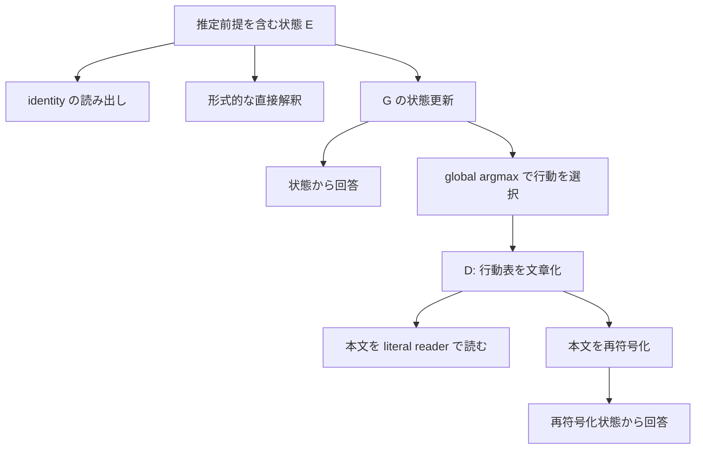

# G の更新と読み出しは、どこで分かれるか

PR #27 の保存済み状態・出力を対応付けた事後診断。基点は
`ba20b3125ac498ef1f2fa21730eef3557e3dd953`。

**結論：構造化 G では、推定済み前提を固定した更新は形式的な直接解釈と完全一致する。そこでの未達は、前提の取り違え、soft な行動表と文章化される行動の不一致、文章の読み出しに分解できる。native G では数値更新を確認できるが、回答が A に固定され、意味的な更新と読み出しの失敗をまだ分離できない。**

この診断では新しいモデル forward・学習を行っていない。資格試験 24 群は開封せず、人手評価も追加していない。元の結果・gate・preprint v1 を変更せず、`NOT_QUALIFIED` を維持する。追加測定の仕様は [開発用事前登録案](../../docs/G_STAGE_DEVELOPMENT_PREREGISTRATION.md) に分離した。仕様は `DESIGN_ONLY_NOT_EXECUTED` であり、実装・入力・採点器を束ねた実行マニフェストの凍結は測定前に行う。

## 1. どこを同じにできたか

保存済み資料から、次の単位で個別の予測と A/B score を結合した。

`文面 panel・方策・source order・world・answer order`

source と question の文字列 hash、reader、注入 geometry を別に保持する。同じ style 番号でも、一次 panel と継続 panel の文面は異なるため、同一入力として結合しない。hash の方式も、既存の canonical JSON digest と UTF-8 本文の SHA256 を区別した。

| 比較 | 保存済み資料で対応付けられる範囲 | 評価条件 |
| --- | --- | --- |
| structured identity／直接解釈／G | 各 panel 1,280 方策・10,240 判断 | 同じ native row reader、同じ行動選択の問い |
| structured G／D(G) の literal read／E(D(G)) | 各 panel の同じ方策・world・answer order | literal と row read は質問処理・adapter が異なる |
| 継続前／継続後の literal reader | 新規文面の同じ D 本文・同じ問い 10,240 判断 | reader のみを変更した対応比較 |
| native E／4種類の G／teacher | 128 方策・1,024 判断 | 同じ raw reader と世界条件付きの問い |
| native D／E(D) | 事前指定の 16 方策・128 判断 | 112 方策分は未測定 |
| structured／native | 一次 panel 内の共通 128 方策・1,024 判断 | 意味上の問いは同じ。物理的な評価条件は異なる |

structured は外部の world address で行を選び、その行動を二択で読む。native は状態全体と world を含む質問を受け取る。reader の重みと注入層も異なる。したがって、下の共通 subset 表を G 単体の因果効果とは扱わない。[比較契約](comparison_contract.json) · [全 1,024 行の対応表](matched_primary_overlap.csv)

| 経路 | 共通 128 方策の 1,024 判断 | D まで揃う 16 方策の 128 判断 |
| --- | ---: | ---: |
| structured identity | 896 | 112 |
| 同じ推定前提への形式的直接解釈 | 1,024 | 128 |
| structured G | 1,024 | 128 |
| structured D(G) の literal read | 720 | 92 |
| structured E(D(G)) の row read | 1,024 | 128 |
| native identity | 503 | 64 |
| native boundary G | 507 | 64 |
| 正しい successor の native 符号化 | 504 | 64 |
| native D(G) の literal read | 128 判断のみ測定、64 正答 | 64 |
| native E(D(G)) の read | 128 判断のみ測定、64 正答 | 64 |

native の「同じ推定前提への直接解釈」は、前提 decoder 自体が保存されていないため未測定である。独立 Boolean ledger の正解を、この欠けた比較の実測値で代用しない。欠測セルには `present:false` または明示した未測定 status を置き、0 点で埋めていない。

## 2. 更新・文章化・再符号化の経路



この図は structured route の分解である。native D は argmax renderer を用いず、8 slots から自由生成する。**D の本文を literal に読む経路と、本文を再符号化する経路は並列**であり、誤った A/B 回答を再符号化しているのではない。

正しさも二つに分ける。元の方策に対する task correctness と、実際に書かれた文章を忠実に読んだかという readout fidelity は異なる。誤った文章に逆らってたまたま元の答えを選んだ場合、前者は正答でも後者の成功ではない。

## 3. 構造化 G：演算を固定すると、失敗の入口が見える

### 3.1 同じ推定前提に対して、G は形式規則と完全一致

推定された通常行動・例外行動・trigger・veto と役割 bit を用いて、形式的な veto 適用を独立に再構成した。両 panel とも次が一致する。

- inferred fields から組んだ入力表の global action IDs。
- その trigger から書かれた参照行の role bit。
- 形式規則を適用した **全 floating-point rows** と保存済み G rows。
- `analytic` と `updated` の dispatch、最上位 token、A/B score。

つまり、この保存範囲では、推定済み入力を固定した後の structured updater／書き込みの差は残らない。identity は pending veto を持ちながら未解決の表をそのまま読むため、G の改善はその条件を反映させる効果である。同じ情報を読む直接解釈への追加の正確さは **0 件**だった。[再計算コード](audit_structured.py) · [行ごとの記録](structured_matched.jsonl.gz)

### 3.2 一次 panel の残差は veto の取り違えに局在する

一次 panel では action fields 2,560 個、role 1,280 個、trigger 1,280 個がすべて正しい。veto だけが 128/1,280 件で left-off から right-off に取り違えられていた。

G と reader を固定し、真の veto だけを差し替えると 9,984 → **10,240/10,240**。新たに正しくなる 256 判断、壊れる判断 0。これは再学習でも新規 forward でもなく、実際に保存されている同一の物理 row と score の再利用による介入である。

### 3.3 新規文面は、複数の取り違えと相殺を含む

新規文面では trigger が 160/1,280 件、veto が 128/1,280 件、action field が 120/2,560 件で誤る。role は 1,280/1,280 正しい。全 field が正しい 952 方策では、global 行動表も native 判断 7,616/7,616 も完全に正しい。

| 新規文面の前提介入 | native 正答 / 10,240 | 元の G から修復 | 元の G から破壊 |
| --- | ---: | ---: | ---: |
| 保存済み推定のまま | 9,472 | — | — |
| trigger のみ正解へ | 9,696 | 280 | 56 |
| veto のみ正解へ | 9,584 | 168 | 56 |
| trigger と veto の両方を正解へ | 9,920 | 448 | 0 |

単独修復は単調ではない。trigger と veto が両方誤っていても、26 方策は global 表が完全に正しく、208/208 の native・literal 判断が正しかった。例えば、本当は right-on が例外を起こし、同じ right-on がそれを取り消す方策で、両方を left-on と誤読しても、現在の行動表は「常に通常行動」のままになる。片方だけ直すと、この相殺が壊れる。

両 field の修復後にも 320 native 誤答が残る。これは元の G が形式規則を間違えて適用した残差ではなく、同じ action rows とその読み出しを保持した条件での残差である。正しい行動 ID への差し替えなど、未実施の条件まで推測で埋めない。

また、stable 方策の平均正答だけを見ると、新規文面で G は 56 判断を修復し 56 判断を破壊し、差が 0 になる。しかし全 world・両順序で完全な stable 方策は **424 → 396/512** に減る。一次 panel でも **512 → 480/512**、64 判断が壊れている。[field 介入・正誤遷移の全表](structured_analysis.json)

## 4. A/B で読めた意味と、文章になった行動を区別する

### 4.1 新規文面では「正答できるが、別の行動名を書く」

| 指標 | 一次文面 | 新規文面 |
| --- | ---: | ---: |
| G の native 正答 | 9,984/10,240 | 9,472/10,240 |
| global argmax が正しい行動 row | 4,992/5,120 | 4,624/5,120 |
| 全 global rows が正しい方策 | 1,152/1,280 | 986/1,280 |
| native で全問正答する方策 | 1,152/1,280 | 1,012/1,280 |
| argmax が提示メニュー外の row | 0/5,120 | 160/5,120 |

新規文面では、hard 化された行動が誤っているのに native では正答する判断が **224 件**ある。具体例は、centimeters を通常行動、inches を例外とする方策である。保存済み row の最大成分は degrees Celsius = 0.6080648、centimeters = 0.3725438。native reader は centimeters/inches から centimeters を選ぶが、renderer は global argmax に忠実に degrees Celsius と書く。

ここでは二択で正答できることから、文章化された命題が正しいとは言えない。160 rows・320 判断では、提示選択肢に degrees Celsius 等が存在しないため、その本文に忠実な A/B 正解がない。これを `TARGET_OUTSIDE_OPTIONS` とし、task score と literal fidelity の分母を区別する。

renderer の文字列は両 panel 全 1,280 表で global argmax と一致した。したがって renderer の転記バグは検出されていない。ただし soft → hard の機能的損失を、同じ reader の介入で確定する測定はまだない。次の S 実験で、同一 prompt に soft row とその one-hot argmax を入れ替えて検査する。

### 4.2 正しい文章が既に出ていても、literal reader は誤る

| 条件付きの literal 正答 | 一次文面 | 新規文面・継続後 reader |
| --- | ---: | ---: |
| 問われた row が正しい場合 | 8,098/9,984 | 7,812/9,248 |
| 表全体が正しい場合 | 7,412/9,216 | 6,564/7,888 |

問われた row に正しい行動が明記されているのに読めない判断は、一次 **1,886**、新規 **1,436**。これは G の構成失敗と分離できる。全 field が正しい新規 952 方策でも、literal は 6,292/7,616 にとどまる。

新規文面の G-native → literal を個別に対応付けると、正から誤へ 1,540、誤から正へ 118。失われた 1,540 のうち 1,436 は正しい hard row に対する誤読で、104 は native 正答と誤った hard row が併存する例だった。118 の「改善」を、そのまま意味の修復とは呼べない。元の方策とは違う本文を読んで偶然 source gold に戻る例が含まれる。

reader の継続前後は、同一本文・同一質問で比較できる。7,560 → 8,050 の net +490 の内訳は **862 修復・372 破壊**。独立に作った正しい oracle 表でも 7,840 → 8,440、**1,000 修復・400 破壊**だった。G の再学習による改善ではない。

### 4.3 再符号化は回答を保存したが、状態と score を保存したわけではない

両 panel とも G と E(D(G)) の最上位 token は **10,240/10,240** 一致し、global argmax も **5,120/5,120 rows** 一致した。一方、float rows のバイト一致は **0/5,120**。A/B scores も一致せず、最大絶対差は一次 1.259765625、新規 13.464061737060547。

この往復で保たれたのは、今回の hard action ID と観測済み二択回答である。元の soft evidence、確信の形、次の未測定判断まで保持したとは判定できない。新規の誤った global action IDs も往復で保持されているため、元の G と同じ正答率であること自体は完全な意味保存の証拠にならない。

## 5. native G：数値更新はあるが、回答は切り替わらない

E と boundary G は **128/128** で hash が違い、G の各 source の hash も 128 種類ある。対立する方策同士もすべて別 hash になる。物理的に E をそのまま返した候補ではない。

しかし、保存済み full-vocabulary winner は次のとおりだった。

| 経路 | 元の採点での正答 / 1,024 | A/B 同点 | 最上位 token |
| --- | ---: | ---: | --- |
| E identity | 503 | 19 | 全件 A |
| plain G | 500 | 19 | 全件 A |
| decompose G | 503 | 17 | 全件 A |
| boundary G | 507 | 13 | 全件 A |
| reintegrate G | 506 | 15 | 全件 A |
| 正しい successor の独立符号化 E* | 504 | 15 | 全件 A |

identity → boundary の 4 正答増加は、gold=A の同点が非同点になった 4 判断である。token の切替は **0**、margin の厳密な符号反転も **0**。しかもこの 4 判断はすべて、veto による修正が必要な world の外だった。必要な world の修復は 0。

同点を無視して greedy label だけを数えれば、表の六経路はすべて 512/1,024 になる。これは診断用の補助値であり、同点を不合格にする凍結済み採点を変更していない。両 A/B 順序で同じ意味の行動を維持できた world は全経路 **0/512** だった。

一方、A/B score の組自体は 1,019/1,024 判断で変わる。よって数値的な感度はあるが、その差がこの離散的な行動選択に利用されていない。正しい target text の符号化 E* まで読めないので、G だけに失敗を帰属できない。原文を literal に与える経路も 523/1,024 で、全体の質問読解にも制約がある。[全経路の再計算](native_analysis.json)

raw archive に保存されているのは E／boundary の hash、transport の重み、出力と score であり、E／post-writer W／T(W) の実テンソル列はない。したがって、この記録だけで writer と transport のどちらが必要な区別を失わせたかは判定できない。

native D の 32 生成はすべて EOS・13 tokens、同じ本文だった。

> Please provide the current description you want me to summarize.

本文に方策固有の区別がないことは直接確認できる。D(E)、D(G)、各再符号化の 128 判断も全件 A、64 正答。区別は遅くともこの出力時点までに利用不能になっているが、最初に失われた場所が D なのか、その前なのかは未同定である。

## 6. 一つの方策を、六つの経路で追う

一次 panel の key `[1,1,3,0,0,0]`、world=3、answer_order=1。

方策は「通常は川沿い。左信号が on なら尾根沿い。ただし右信号も on なら通常行動を優先」。両信号が on の問いなので川沿いが正しく、選択肢は **A=尾根、B=川**。

| 経路 | 回答 | 元の方策に対する判定 |
| --- | --- | --- |
| structured identity | A | 誤り |
| 同じ推定前提への直接解釈 | B | 正しい |
| structured G | B | 正しい |
| native boundary G | A | 誤り |
| structured D(G) の literal read | A | 誤り |
| structured E(D(G)) | B | 正しい |
| native D(G)／native E(D(G)) | A／A | 両方誤り |

structured G と直接解釈は A/B margin も同じ −17.75。D 本文の当該 row は正しく川沿いを指定するが、literal reader は尾根を答える。これは「更新も記述も成立しているが、literal read が使えない」という具体例になる。native 側は同じ authored policy を持つものの評価 interface が違うため、表の差だけでその G が更新に失敗したとは判定しない。

## 7. 追加する測定は三つ

| 実験 | 固定するものと変更するもの | 新しく識別できること |
| --- | --- | --- |
| S：soft と hard | 同じ保存 row・prompt・reader で soft／global one-hot／oracle one-hot を比較 | 単一行動へ絞る時点の機能的損失と reader の能力不足 |
| N：native 中間状態 | 既存 128 sources と boundary を固定し、E、W、T(W)、実際の注入 J を保存 | writer／transport／注入の数値的な消失・実装不一致 |
| C：共通質問と reader | 既存 D subset 16 sources の同じ 128 問いを、固定した二 reader と全経路へ交差 | 状態と reader の相互依存、D 本文と再符号化の差 |

既存 generation は選び直さず、source・G・transport・role bit・renderer・既存 readers を再学習しない。未使用の一般化試験ではなく、既に公開された開発資料での診断である。正の対照が読めない場合は `UNRESOLVED_READER_OR_CARRIER` を残す。補助 probe の失敗や距離の小ささから、意味が存在しないとは結論しない。詳細な実行範囲・停止規則・対応表は [仕様](../../docs/G_STAGE_DEVELOPMENT_PREREGISTRATION.md) にある。

## 8. 形式的な直接解釈を超えるには、何を獲得すべきか

現在の完全な Boolean 前提 P に対し、形式的な F(P, world) が正解を決める。同じ情報で同じ問いを解く限り、G に論理的な新事実の上乗せを要求する比較にはならない。

次の候補で意味のある獲得は、(a) 誤りや不確実さを含む同じ evidence からの頑健な前提回復、(b) 正しい区別を後の reader が使える状態に書くこと、(c) 実際の言語化と再符号化の後にもその区別を使えること、(d) 現在の行動表では同じに見える役割・履歴を、次の更新のために残すことである。計算費用の改善を狙うなら、F にも事前計算・cache を許し、G の前処理と保存量を含めて比較する。

今回の結果が直接支えるのは、structured では (a) の取り違えと (c) の読み出しが局在し、native では (b) を認定する測定 interface が未成立だという整理である。まず S・N・C によって、正しい更新を書けなかったのか、書かれた区別を読めなかったのかを判別する。成功率を一つ増やして、これらの違いを埋め合わせない。

## 9. 再現性と成果物

再計算は CPU と NumPy のみ。元の summary 3 本と field intervention 2 本をそのまま再現し、元の checksum manifest 内の 70 ファイルを検証した。分析に使う source/data は PR #27 の Git blob と照合する。資格試験の内容を読み込む経路は使わない。[検証記録](verification.json) · [入力 manifest](input_manifest.json)

```bash
python provenance/g_stage_diagnostics_20261104/audit.py --out /tmp/self-fold-g-stage-replay
python tests/test_g_stage_diagnostics.py -v
```

出力先は未作成のディレクトリが必要。既存の evidence を上書きしない。追加の 7 テストは、元の集計の一致、同一評価条件の識別、欠測、同点由来の増分、hard action と二択正答の差、文面 ID の取り違え、上書き拒否を検査する。モデルを用いた再実行や、リポジトリ全体の学習テストを実施したという意味ではない。

| ファイル | 内容 |
| --- | --- |
| [audit.py](audit.py) | 全再集計・対応表・元結果の検証 |
| [structured_analysis.json](structured_analysis.json) | 前提・更新・記述・読み出しの分解、修復／破壊の内訳 |
| [native_analysis.json](native_analysis.json) | 全 22 経路、18,944 記録行、同点と状態 hash の診断 |
| [structured_matched.jsonl.gz](structured_matched.jsonl.gz) | 2 panel、20,480 判断の対応記録 |
| [native_matched.jsonl.gz](native_matched.jsonl.gz) | 1,024 判断の各 native 経路、欠測を明示 |
| [matched_primary_overlap.csv](matched_primary_overlap.csv) | 共通 128 方策を跨ぐ記述的な対応表 |
| [comparison_contract.json](comparison_contract.json) | source・question・reader・geometry・採点 target の違い |

これらは事後的な開発診断であり、独立確認の成功や preprint v1 の追加結果として取り扱わない。
